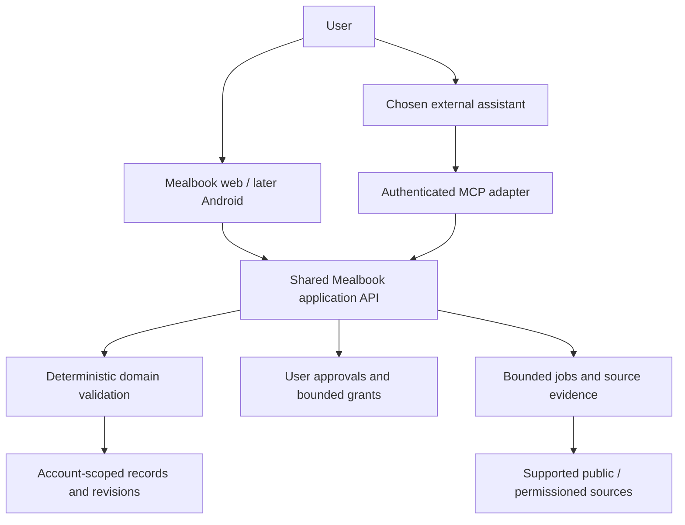

# Agent-friendly Mealbook

Mealbook should let a person use their chosen assistant to turn recipes into a week they can shop for and cook. The assistant supplies language understanding and recommendations; Mealbook supplies source evidence, validated operations and trustworthy records. This direction was approved October 27, 2026. This pass documents it: **no MCP server, new account store, synchronization or agent write API is implemented yet**.

The default product remains useful without an assistant. Today, My week, Recipe book and Shop retain their shared card identity. An external assistant works on the same recipes, plans and food records—not a second, disconnected recipe book.

## Who supplies inference

The person connects an MCP-capable assistant to Mealbook. Their assistant/provider handles reasoning under its own account, subscription or API arrangement. Mealbook does not ask for a Claude/OpenAI API key, resell inference or run a conversational agent loop. Consumer client subscriptions and developer-billed model APIs are different integrations; the [client research](../../research/agent-integrations/README.md) records current support.

This removes model orchestration from the mandatory Mealbook service, not all operating cost or responsibility. Mealbook still operates authenticated tools, source retrieval, validation, storage, jobs, quotas, support and applicable subscription rules. The assistant vendor may receive the authorized recipe/preferences/tool-result data; connection consent must explain that boundary.

The existing managed-model importer remains unchanged in the personal app. Its current provider request is not already a bring-your-own-agent path. The new path must split retrieval from extraction and preserve the ordinary manual/import UI; see [the source contract](../../reference/source-ingestion.md) and [tool contracts](../../reference/agents/tool-contract.md).

## One application API, three consumers

The web client, later Android client and MCP adapter should call the same account-scoped application service. That service applies shared domain validation and transactional state changes. MCP is a thin protocol adapter, not a database connection, browser scraper or independent business-rule implementation.

The model never bypasses the service to write database rows. OAuth scope, current account ownership, operation policy, revision and quota are checked on each request. A tool handle is an identifier, not permission. App-visible changes carry origin, time, review status and a way to inspect the actual result.

## Connecting the present private app

Today the editable book, cooking, shopping and logs live in browser IndexedDB, with no signed-in account or server personal-data database. The current API only exposes health, import capability and recipe preview. A remote MCP endpoint cannot access that private browser store by itself.

The first development milestone should prove a real shared-workspace connection. Add a user-enabled browser pairing bridge to the **existing private app**, with a loopback companion and short-lived scoped pairing credential. Bind the companion to localhost, validate origin/host, and require the user to select the actual app origin. The bridge reads and dispatches through the app's command boundary; the browser remains the authority in this local milestone. An app that is closed/disconnected returns `APP_DISCONNECTED` rather than writing a fake server book. Test against an isolated profile before connecting the owner's real data.

A backup-derived fixture can support unit tests, but must be labelled a fixture. It is not proof of bidirectional application integration. No browser-wide IndexedDB scraping, filesystem secrets or default unbounded local port exposure.

The commercial remote milestone depends on the approved [account and sync architecture](../data-and-sync.md). The user explicitly migrates or syncs selected local data to their visible account. Web/Android and MCP share the same records and revisions; an offline edit and an agent edit produce visible conflict handling, not silent overwrites. Commercial clients do not rely on the user's browser staying open.

## How the recipe-to-week loop changes

The user sends a supported recipe/video link to their assistant. Mealbook fetches allowed text/metadata and returns a source handle, retrieval status, content hash and evidence locations. The assistant proposes recipe fields from those source chunks. Mealbook validates schema, source quotes, ingredient identities/units, yield and nutrition basis, preserving unknown values. User-supplied corrections are labelled as corrections, not fabricated creator facts.

A validated draft remains pending until the user approves it or an eligible narrow grant covers that save. The accepted recipe becomes the same book record used by the app. The assistant can read goals, actual cooking opportunities and available prepared food only within granted scopes, then request a plan preview or submit candidate choices. Mealbook calculates quantities, nutrition completeness, target residuals and grocery differences. A plausible narrative is not proof of a feasible plan.

The user can approve the week, inspect Shop and ask for replacements. Cooked/locked choices and historical food snapshots remain protected. An assistant can explain the next cooking step, but elapsed time or a completed calendar slot does not mean a batch was produced or food was eaten. Those physical facts require explicit confirmation.

## What belongs where

Source policies and evidence retrieval belong to the source service. Validation, exact arithmetic, incompatible-unit handling, nutrition completeness and state transitions belong to Mealbook's deterministic domain. Suggestions, phrasing and choice explanations belong to the external assistant. Consent, standing permissions, real-world completion and destructive approvals belong to the user.

Numerical target fitting remains a future capability. Initially an agent may propose a candidate week and Mealbook may evaluate it; neither side can claim a full-day target fit with incomplete food coverage or unknown macros. Announce supported capability versions so clients can discover that limitation without guessing.

Ollaya/Laya remains an optional later labeling/ranking adapter under [the existing decision-model evaluation](../decision-models.md). It is not a prerequisite for MCP or a substitute for arithmetic. External reasoning is the default; any hosted decision experiment needs its own value, privacy and cost evidence.

## Design and implementation contracts

[Tool contracts](../../reference/agents/tool-contract.md) define the data/action interface and recovery. [Permissions](permissions-and-trust.md) owns approval semantics. [Scaling](scaling-and-operations.md) defines staged deployment rather than premature infrastructure. [Web experience](web-experience.md) preserves agent-friendly interaction without replacing cards with chat. [The implementation plan](../../plans/2026-10-27-1205-feat-agent-friendly-mealbook-plan.md) specifies future work; it is not permission to build or publish it in this documentation pass.

## References

1. [MCP transport bindings](https://modelcontextprotocol.io/specification/2026-07-28/basic/transports)
2. [MCP authorization](https://modelcontextprotocol.io/specification/2026-07-28/basic/authorization)
3. [MCP tool schemas and explicit state handles](https://modelcontextprotocol.io/specification/2026-07-28/server/tools)
