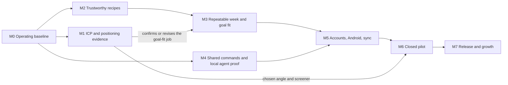

# Milestones and gates

Updated October 28, 2026. Each milestone maps to a stage of the [commercial roadmap](../roadmap/commercial-release.md) or adds a step it lacked. A milestone is a gate: it closes when its exit criteria have `measured` or `observed` evidence and the owner passes the gate review described in [the operating loops](README.md#l3--gate-review-each-milestone). No milestone has a date. Thresholds marked *proposed* are starting values the owner confirms at the milestone's kickoff; once confirmed they are written into the epic and are not changed after results are seen.

Two tracks run side by side. The **build track** is M0 → M2 → M3 → M5 → M6 → M7, with M4 alongside M2–M3. The **growth track** is M1, which starts now because the build track's most expensive steps (numeric goal fitting, accounts) depend on what it finds.

## M0 — Operating baseline

**Objective:** Every change is checked automatically, the core loop has a reproducible browser test, evals have baselines, and the owner uses the real app every week.

**Entry:** None. Started October 28, 2026.

**Exit gate:**
- CI runs docs, type, unit and build checks on every pull request and `main` push, and is green on `main`.
- An automated browser smoke test covers Today → cook → ready food → eat → Undo → confirmed week → shop purchase, and runs in CI (EV-03).
- The evals register exists with baselines for EV-01 and EV-02.
- The owner has decided how they run Mealbook daily (which deployment or local install), recorded as a dated decision.
- The dogfood log (EV-08) has entries for two consecutive weeks.

**Kill/pivot:** Not applicable. If the owner cannot use the app weekly, find out why before any other milestone proceeds; that is the cheapest evidence available.

## M1 — ICP and positioning evidence (growth track)

**Objective:** Replace the customer and positioning hypotheses in [STRATEGY.md](../../STRATEGY.md) with observed evidence before the build track commits to numeric goal fitting and accounts. Method: [growth](../growth/README.md).

**Entry:** M0 started. Runs alongside M2.

**Exit gate:**
- A listening map names where the target segment discusses meal prep, recipe saving and macro planning, with their vocabulary, dated.
- An evidence ledger holds at least *40 (proposed)* observed signals from public posts and competitor reviews, each coded to a job, pain and confidence tier.
- At least *5 (proposed)* problem interviews with people who pass the screener, run by the owner from an agent-prepared guide, with an agent synthesis.
- Funnel map v1 is accepted by the owner, replacing the inferred v0.
- Two or three positioning angles are scored against the ledger; one is chosen, with the test that the M6 pilot will run on it predeclared.

**Kill/pivot:** If the core job ("turn recipes I saved into a prep week and one shopping list that fits my targets") appears in fewer than *25% (proposed)* of coded pain signals, or interviews do not rank goal fit among the top three pains, revise `STRATEGY.md` with `ce-strategy` before M3 starts.

**Out of scope:** Paid acquisition, campaigns, public posting, scraping contact lists. Reading public posts is allowed; contacting people is owner-only.

## M2 — Trustworthy recipes and nutrition (roadmap stage 1)

**Objective:** Every recipe fact the app shows has a provenance level, unknown stays unknown, and source import fidelity is measured.

**Entry:** M0 CI green.

**Exit gate:**
- Domain types carry a provenance level per nutrition field and yield (`creator-reported`, `user-entered`, `dataset-calculated`, `reviewed`, `unknown`); recipe composition edits invalidate dependent values; version-one backups still restore (EV-01).
- EV-02 reports per-provenance coverage; no code path turns unknown into zero (property test).
- A source-fidelity held-out set (EV-04) of at least *30 (proposed)* sources meets thresholds predeclared in its plan for ingredients, units, yield and serving basis, with denominators and abstentions reported.
- Import cost, failure rate and correction time are measured on a sample.
- A content-rights register v0 covers the seed recipes and images.

**Kill/pivot:** If held-out fidelity cannot reach its thresholds after one improvement cycle, narrow supported sources and say so in the product rather than lowering the bar.

## M3 — Repeatable week and goal fit (roadmap stage 2)

**Objective:** A person can reach a usable second prep week, with numeric goals shown honestly: fitted where data allows, partial or impossible where it does not.

**Entry:** M2 provenance shipped. M1 has confirmed the goal-fit job matters, or `STRATEGY.md` has been revised.

**Exit gate:**
- The week scenario suite (EV-05) passes: feasible and impossible goals, partial-day disclosure, unknown macros or yield, locked recipes, edited composition, leftovers, changed cooking windows, exclusions and purchase invariants.
- The owner's dogfood log shows a useful second week reached with the new planner.
- Moderated usability (EV-10) with at least *5 (proposed)* screened participants: at least *4 (proposed)* reach a usable first week; time and corrections recorded.

**Kill/pivot:** If participants reach a first week but not a second, fix the repeat loop before adding planner features.

## M4 — Shared commands and local agent proof (roadmap stage 3A, units U1–U2)

**Objective:** One command and query boundary serves the UI and a local MCP bridge, proven on the real app, before any remote agent investment. Plan: [agent-friendly Mealbook](../plans/2026-10-27-1205-feat-agent-friendly-mealbook-plan.md).

**Entry:** M0 CI green. Can run alongside M2 and M3.

**Exit gate:**
- U1: UI actions go through the shared boundary; parity tests pass; identical retries have one effect.
- U2: the local bridge completes a source → book → week → shop scenario in an isolated real app profile; acceptance examples AE1–AE5 are automated (EV-06).
- The user-outcome comparison from the plan is predeclared and run with intended users; its result decides whether remote MCP work proceeds.

**Kill/pivot:** No measurable improvement over the manual loop → refine the agent workflow; do not start remote MCP.

## M5 — Accounts, Android, sync and entitlements (roadmap stage 3)

**Objective:** The same records reach a native Android client and the web, with consented migration from on-device data.

**Entry:** Owner decisions O002 (providers and budget) and O003 (guest-to-account migration) recorded; M3 gate passed; M4 U1 shipped.

**Exit gate:** The roadmap's stage 3 gate: physical-device and interrupted-network tests, backup migration and restore, no cross-user leakage, purchase/expiry/refund webhooks and support exercises in staging. The Android client reuses `packages/meal-domain/` and the card system; the owner's private Storyteller companion app informs interaction patterns (one viewer for every entry path, reduced-motion handling, single-key position memory, config-plugin signing), never its content.

**Kill/pivot:** If sync or entitlements cannot meet the isolation and restore tests, ship Android without accounts first rather than weakening isolation.

## M6 — Closed pilot (roadmap stage 4)

**Objective:** Measure whether qualified people reach a second week, pay and renew.

**Entry:** M5 gate passed; the closed-beta items in [production readiness](../release/production-readiness.md) signed off; M1's angle and screener ready.

**Exit gate:** 30 screened participants; the predeclared rules of 20 usable first weeks, 12 second weeks, 8 payments and 5 first renewals evaluated with denominators, dropout reasons and refunds (EV-11).

**Kill/pivot:** Import without a second week → fix capture and activation. Second week without payment → packaging or automation value. Payment then cancellation → retention or trust. Do not answer any of the three with more imports or AI marketing.

## M7 — Release and growth (roadmap stage 5)

**Objective:** Public Android and web release with honest claims, then measured growth.

**Entry:** Go/no-go in [production readiness](../release/production-readiness.md) passed.

**Exit gate:** Defined at M6 gate review from pilot evidence. Growth monitoring follows [growth](../growth/README.md): baselines recorded and events confirmed firing before any launch beat, then reviews at day 9 and day 30.
