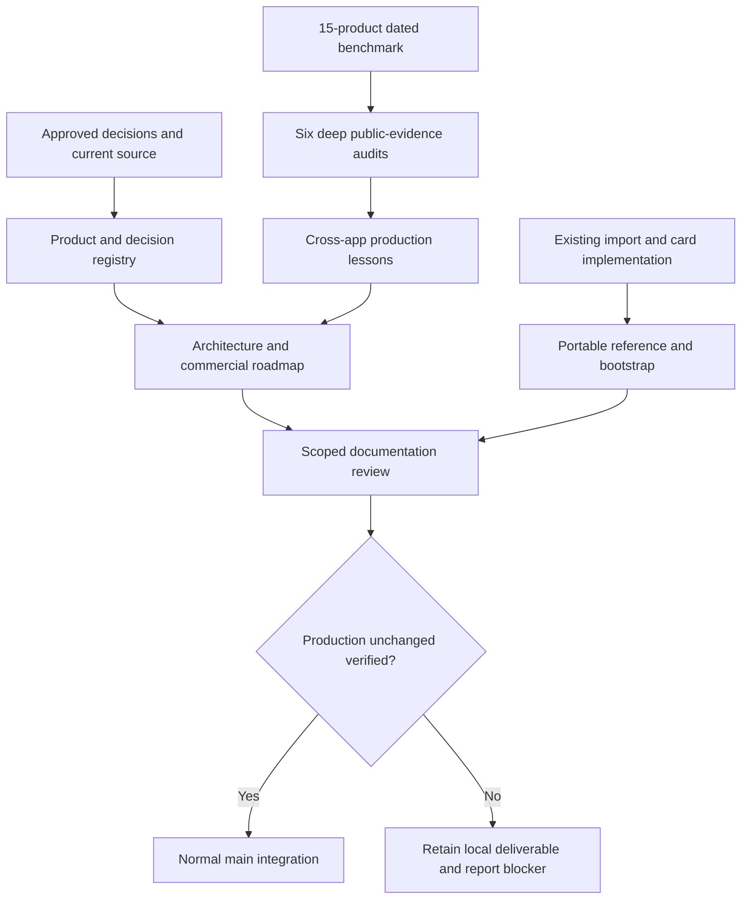

# Commercial Foundation Documentation - Plan

## Goal Capsule

**Objective:** A new contributor can understand what Mealbook is for, distinguish delivered behavior from commercial-release gaps, reproduce the source foundation and select the next release milestone without reconstructing conversations.

**Means:** A versioned, source-linked documentation system grounded in the running source and public competitor evidence, with a protected source integration boundary (KTD1–KTD3).

**Authority:** User-approved product decisions govern behavior; `PRODUCT.md` and the experience contract preserve the personal foundation; `STRATEGY.md` governs proposed commercial positioning; recommendations and estimates are never silently promoted to approved implementation. The six-audit brief was approved on October 27, 2026.

**Execution boundary:** This run writes documentation and bounded reference deliverables (finite metadata collection, read-only recipe exports, an environment template and local documentation checker), then integrates existing application code. These reference tools are explicitly within the approved self-contained-source scope and need functional validation. No application UI/domain/runtime feature, deployment configuration, accounts, paid entitlements, synchronization, inference hosting or numerical goal fitting is implemented here. Stop the remote push if production deployment cannot be kept unchanged. The maintainer authorizes any eventual commercial release separately.

---
## Product Contract

### Summary

Retain the implemented Today-first app and document how it can become a competitive consumer product. Preserve the 15-product commercial benchmark; extend six priority products with public-evidence audits of their operating and commercial patterns. Package the reference material inside the central repository.

### Problem Frame

The implementation and research are spread across conversation history and preparation files. Without durable boundaries, a future contributor could mistake macro filters for a numeric optimizer, a private recipe research bank for a licensed public catalog, or a Git push for approval to launch a paid service.

### Requirements

**Knowledge and evidence**
- R1. Document the goal, target customer, positioning, paid-value hypothesis, settled decisions and open product/vendor questions with current-versus-planned labels.
- R2. Audit the six approved competitors across profiles, entitlements, recipes, data/sync, technical evidence, upselling and marketing; distinguish observed claims, untested behavior and unknown internals.
- R3. Retain the prior market evidence with dated source links, pricing uncertainty and the distinction between downloads, ratings, estimates and actual sales.

**Release and reproducibility**
- R4. Describe production client/server responsibilities, ownership/isolation, data migration, billing lifecycle, nutrition/optimization, operations and release gates without implementing them.
- R5. Make source fetching, seed/export reproduction, card-system references and bootstrap instructions portable; prohibit private deck content, secrets and restricted binary redistribution.
- R6. Define an optional decision-model layer with evaluation and manual fallback, separate from arithmetic and safety facts.
- R7. Preserve app behavior and history, and push the approved code/docs to central `main` only when deployment safety is established.

### Key Decisions

**Use existing app plus docs, not another feature build** (session-settled: user-approved — chosen over immediately implementing payments/accounts: first establish the production approach). Governs R1, R4.

**Audit public facts, not guessed infrastructure** (session-settled: user-approved — chosen over reverse-engineered private-stack assertions: unsupported internals are explicitly unknown). Governs R2, R3.

**Production stays unchanged during source integration** (session-settled: user-approved — chosen over permitting a main-triggered release: separate source ownership from deployment). Governs R7.

### Scope Boundaries

Provider provisioning, paywalls, new production database tables, native packaging, legal clearance and customer acquisition execution are follow-up work. Creating public marketing claims or distributing paid creator content is outside this run. The roadmap sequences those future decisions, not their authorization.

---
## Planning Contract

### Key Technical Decisions

- KTD1. **One navigable repository documentation layer.** `docs/README.md` indexes canonical strategy, decisions, architecture, roadmap, research and reference documents. Existing experience docs remain authoritative for delivered interactions; historical reports retain their dates. Implements R1–R5.
- KTD2. **Parallel evidence collection, one comparative synthesis.** One researcher owns each competitor and a reducer owns the cross-app implications. Local source inventory and public documents support separate claims. Implements R2, R3.
- KTD3. **Source integration is not deployment.** Check remote ancestry and deployment controls before any push; never use force. If controls are unverifiable, leave the tested branch intact and deliver the blocker. Implements R7.
- KTD4. **Optional model experiment.** Keep a stable, typed proposal interface and a held-out evaluation contract; no model installation or claimed performance advantage without measurement. Implements R6.

### Documentation data flow

### Assumptions

US-first English-language consumers and Android-first delivery remain the planning market. Revenue, conversion, willingness to switch, import reliability at scale and model benefit are unproven. Roles named in release gates are responsibility areas, not staffed team assignments. Future database, billing and hosting candidates require a later architecture decision before implementation.

---
## Implementation Units

### U1. Preserve market evidence and audit commercial patterns

**Goal:** Give product decisions a verifiable competitive basis. **Requirements:** R2, R3. **Dependencies:** None. **Files:** `docs/research/market/`, `docs/research/competitors/`.

**Approach:** Preserve the original dated market report and CSV, collect six bounded public-source audits, and synthesize implications without inferring private architecture.

**Test expectation:** No behavioral tests; verify citation availability, unique product coverage, fact/claim/unknown labels and repo-relative links. **Verification:** All six reports and the synthesis exist; unavailable evidence is explicit.

### U2. Write strategy, decision registry and commercial roadmap

**Goal:** Define the offer and sequence the work without claiming release readiness. **Requirements:** R1, R3, R4. **Dependencies:** U1 findings. **Files:** `STRATEGY.md`, `docs/decisions/README.md`, `docs/roadmap/commercial-release.md`, `docs/commercial/go-to-market.md`.

**Approach:** Distinguish approved personal behavior, recommended commercial design, launch blockers and validation hypotheses. Keep one owner for each rule and link related documents.

**Test expectation:** No behavioral tests; check that the roadmap maps blockers to owners, evidence and dependencies and does not mark future features delivered. **Verification:** The next milestone and its release restrictions are unambiguous.

### U3. Document production architecture and optional decisions

**Goal:** Make accounts, data, subscription and model boundaries implementable in later scoped plans. **Requirements:** R4, R6. **Dependencies:** U1 and current source. **Files:** `docs/architecture/`, `docs/commercial/subscriptions.md`, `docs/release/production-readiness.md`.

**Approach:** Record current versus proposed topology, private ownership, sync conflicts and deletion, authoritative entitlement lifecycle, arithmetic/data trust and evaluation gates. Provider recommendations remain non-binding.

**Test expectation:** No new app behavior; review restore/refund/account isolation, incomplete-nutrition and unavailable-model scenarios against the proposed contracts. **Verification:** Failure states and launch evidence have named owners; no unsupported competitor-stack or model-performance claims.

### U4. Package independent build, ingestion and card references

**Goal:** A clean checkout contains the material needed to build on the app. **Requirements:** R5. **Dependencies:** Existing source. **Files:** `docs/reference/`, `tools/recipe-import/`, `.env.example`, `README.md`.

**Approach:** Explain existing imports and credentials, retain original card behavior rather than private deck assets, provide bounded metadata collection/export references and document content/font licensing limits.

**Test scenarios:** Reference tools reject invalid inputs and preserve unknown nutrition; sample export retains ingredients/source/serving basis; app build succeeds without the private design repository; secrets and private state remain excluded. **Verification:** Portable commands and file references match real code.

### U5. Review and safely integrate the central source

**Goal:** Preserve a coherent, reviewed source baseline without deploying it. **Requirements:** R1–R7. **Dependencies:** U1–U4. **Files:** `docs/README.md`, `TODO.md`, release evidence and approved first-party files.

**Approach:** Review coherence and feasibility, correct confirmed errors, check source/data boundaries, fetch and preserve remote changes, then integrate only under KTD3.

**Test scenarios:** Local Markdown links resolve; no secret/raw restricted font/private deck content is introduced; existing type checks/tests/build pass; remote main ancestry remains intact; connected production deployment identity stays unchanged if a push is possible. **Verification:** Exact source SHA and deployment outcome are reported, or the retained branch and blocker are delivered.

---
## Verification Contract

Use the repository's actual `pnpm typecheck`, `pnpm test` and `pnpm build` scripts after source-tool integration. Documentation verification checks relative links, artifact presence, source claims and current/planned status. Reference-tool checks write only to temporary output paths. A scoped read-only review checks cross-document contradictions and feasibility; it does not repeat the competitor research.

The native Compound Engineering plugin remains installed. No native model output is used as evidence for this documentation pass. This run applies its installed planning, review and knowledge-retention guidance through runnable host tools and scoped reviewers; it does not claim a successful native model session or a complete formal multi-persona review.

---
## Definition of Done

The documentation entry point resolves to all approved topics, the six audits and preserved market evidence are included, bootstrap/source/card references are independent of private assets, and future work is clearly separated from delivered behavior. Existing behavior remains buildable. Approved source integration is complete only after a normal push and verified remote SHA with production unchanged; otherwise the deliverable remains safely local with an explicit blocker. Temporary research caches, secret-bearing output, dead-end code and unrelated changes are excluded.
