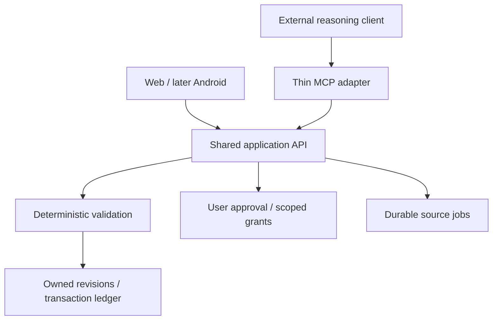
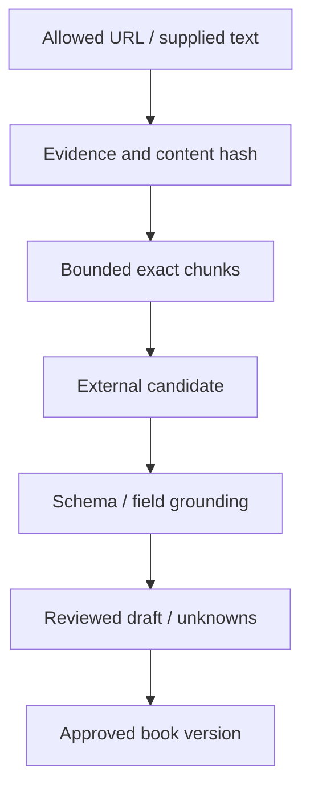
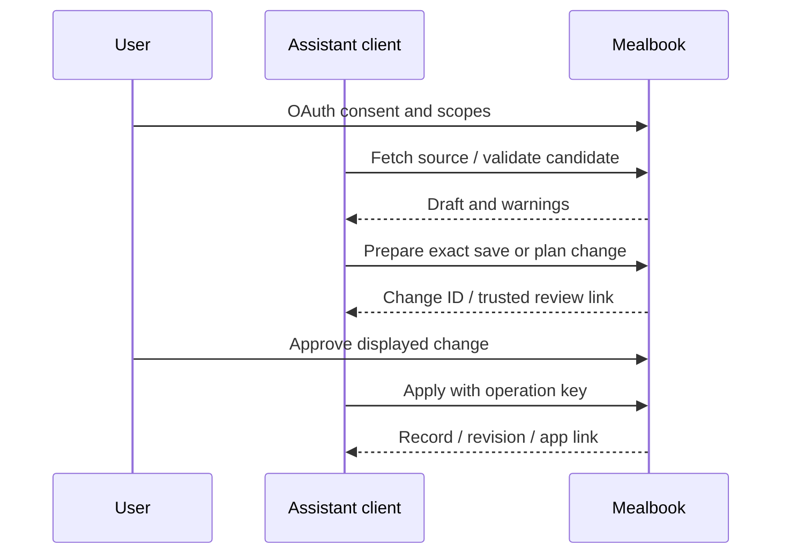
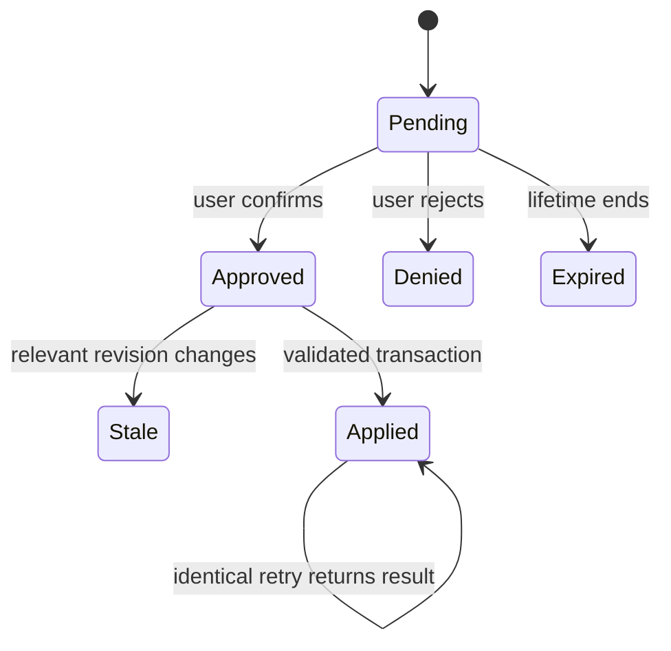
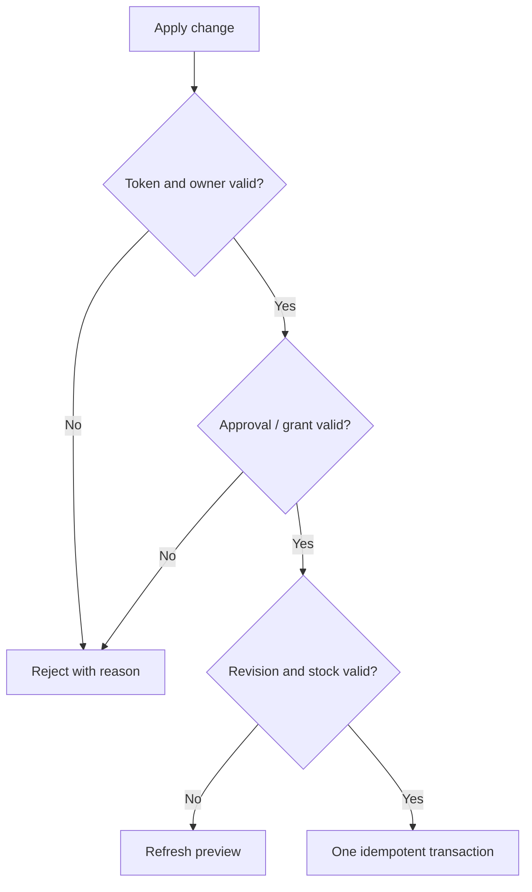
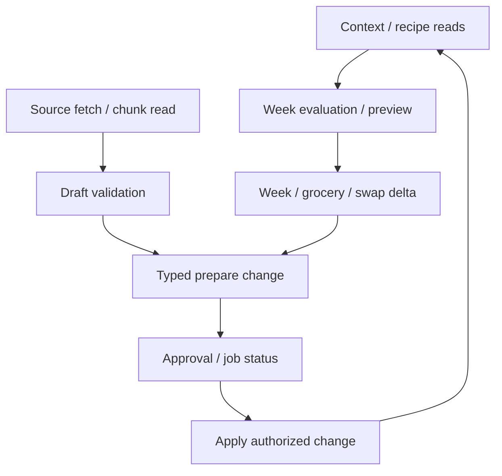

# Agent-friendly Mealbook - Plan

## Goal Capsule

**Objective:** People can use their chosen assistant to turn source recipes into a correct, reviewable prep week and shopping list in their actual Mealbook account, then continue the same food record in the ordinary app.

**Means:** A thin MCP projection of shared Mealbook queries and commands, with reasoning in the user's external assistant (KTD1).

**Authority:** `PRODUCT.md`, `STRATEGY.md` and decisions D010–D012 establish the direction; the contracts linked below own its detailed safety, data and interaction rules. This is a **future code implementation plan**. The October 27 pass researches/documents/pushes it only; it does not execute these units, provision services or publish a connector.

**Delivery boundary:** Preserve the working personal app; a local prototype proves real app parity before account-backed remote alpha. Remote release requires user-selected providers/budget, tested client access and the production-readiness gates. Unsupported clients get an honest subset, not a workaround that disguises writes.

---

## Product Contract

### Summary

Add composable assistant access to the existing capture/review/book/week/shop/cook/eat loop. Mealbook owns source acquisition and validation, exact arithmetic, owned records and controlled changes. The assistant owns reasoning; the user owns consent and actual-world confirmations. The app remains useful without a connected assistant.

### Problem Frame

People discover recipes in browsers and assistants, but copying conversational plans into disconnected tools creates correction and shopping work. An agent that cannot inspect the same recipe versions, portion assumptions and ready food can produce plausible but unusable plans. The present app's private browser state is not reachable through a remote connector by itself.

### Key Decisions

- External reasoning over embedded chat (session-settled: user-approved — chosen over collecting provider keys and running app chat: keep Mealbook focused on correct data/actions). Governs R1, R4.
- Shared application records over a separate agent book (session-settled: user-approved — chosen over fixture-only or scraped browser integration: preserve the real food loop). Governs R2, R3.
- Application-controlled approval over model assertions (session-settled: user-approved — chosen over autonomous real-world/destructive writes: users retain control). Governs R7, R8.
- Agent-friendly cards over chat-first redesign (session-settled: user-approved — chosen over replacing approved navigation: preserve human usability). Governs R10.

### Requirements

**Data and reasoning**

- R1. Users' MCP-capable assistants provide inference without Mealbook collecting model API keys or operating an embedded conversation loop.
- R2. UI, later Android and MCP operate on the same owned recipe versions, plans, shopping state, cooking sessions, prepared food and consumption records.
- R3. A local development bridge uses the actual open app through its command boundary; it never pretends a fixture store or remote IndexedDB access is the app.
- R4. Source fetch and external interpretation are separate; Mealbook validates evidence and preserves unsupported quantities, yields and nutrition as unknown.

**Planning and safe execution**

- R5. Week/swap/shopping previews return precise quantities, known nutrition, target residuals and uncertainty without committing the active plan or real-world food.
- R6. Exact constraints, compatible-unit arithmetic, stock and immutable-history invariants are enforced by the shared deterministic service.
- R7. Writes obey [the application approval and grant contract](../architecture/agents/permissions-and-trust.md), not a client-provided approval assertion.
- R8. Actual cooking completion, consumption/reversal and destructive changes always need a specific explicit user confirmation under that contract.
- R9. Requests preserve [its ownership, revision, idempotency, revocation and job rules](../architecture/agents/permissions-and-trust.md) across retries and conflicts.

**Experience and operations**

- R10. Agent actions use the same approved cards/review/diff/recovery UI, with semantic access and owned deep links as specified in [web experience](../architecture/agents/web-experience.md).
- R11. Claims name tested client/plan/platform capabilities from [dated client research](../research/agent-integrations/README.md); no universal ChatGPT-write promise.
- R12. Operate authenticated, resource-bounded tools using [the staged scaling/compatibility plan](../architecture/agents/scaling-and-operations.md), without optional inference hosting as a dependency.
- R13. Free/Pro follows [service-value packaging](../commercial/subscriptions.md), not inference resale or ransom of existing data.

### Actors and Key Flows

A1 is the user; A2 their assistant/client; A3 the ordinary web/later Android client; A4 Mealbook's command/source/approval service.

F1 — A1 supplies a permitted source; A2 requests evidence that A4 fetches, reads the returned bounded chunks and proposes fields; A4 validates the candidate; A1 approves promotion or an eligible grant covers it; A3 and A2 see the same book version. Covers R1–R4, R7, R9.

F2 — A2 reads scoped goals, cooking opportunities and ready food; requests/evaluates a candidate week; shows nutrition/shopping differences; A1 approves; A3 opens that committed week. Covers R2, R5–R7, R9–R11.

F3 — A1 changes a meal/time; A2 previews an uncooked replacement; Mealbook protects cooked/locked records; approval updates the shopping derivation without erasing history. Covers R5–R7, R9–R10.

F4 — A2 guides the session; A1 explicitly confirms produced units and later intake; Mealbook records immutable snapshots and supports explicit reversal. Planned time never becomes food automatically. Covers R2, R6, R8–R10.

### Acceptance Examples

AE1. A source with two recipes and no stated yield remains ambiguous/unknown until selection and correction; invented creator yield cannot be promoted. Covers F1 / R4.

AE2. A proposed week with incomplete macros remains incomplete even if its prose claims 2,000-calorie fit. Covers F2 / R5.

AE3. A UI recipe/week edit occurs while approval is pending; apply rejects stale revisions and returns a new comparison. Covers F2–F3 / R7, R9.

AE4. A lost consume response is retried with the same application key; one log/stock effect is returned. Two clients competing for the last portion cannot create negative stock. Covers F4 / R6, R8–R9.

AE5. The local browser closes mid-operation; tools return disconnection/known outcome, not a fixture-store write. Covers R2–R3, R9.

### Scope Boundaries

The first slice includes typed queries/commands, real local pairing, bounded source review, approval, account/sync prerequisites, remote MCP and ordinary UI parity. Rich in-chat cards and directory distribution follow tested core support. Native Android is separately executed under the commercial roadmap, reusing the contract.

Outside initial identity: embedded chat, inference resale, arbitrary SQL/shell/browser tools, autonomous actual-food assertions, medical/allergen/storage authority and an unlicensed creator catalog. Considered but not built first: specialized search fleets, global multi-region routing and household delegation; measured load/role demand can justify them later. Ollaya remains independent of the connector.

---

## Planning Contract

### Key Technical Decisions

- KTD1. **Shared typed service, thin adapters.** Extract durable commands from `useMealbook.ts`, retaining existing domain/validation; local and remote repository adapters share that contract. R1–R3, R6 govern it.
- KTD2. **Separate evidence from inference.** Split the current `ManagedRecipeExtractor` invocation from acquisition/grounding. Preserve the current managed path until deliberately replaced; do not advertise it as already external-inference. Governs R4.
- KTD3. **Version-tested OAuth MCP.** Prefer the maintained official TypeScript SDK, with tested modern/required legacy behavior from the actual client matrix. No hand-rolled protocol/auth or presumed latest-spec support. Governs R9, R11–R12; see [standards](../research/agent-integrations/standards.md).
- KTD4. **Persist operations outside transport sessions.** Owned transactions, approvals and explicit job handles survive connection/process loss under the permission contract. Governs R7–R9, R12.
- KTD5. **Same-origin local development proof.** Pair a locally served instance of the existing app with a loopback companion; app-side handlers use that origin's normal state only after explicit pairing. This avoids pretending hosted clients see localhost or bypass browser mixed-content/local-network restrictions. An existing remote origin requires a separately verified bridge or explicit migration. Governs R2–R3.

### High-Level Technical Design

**Components:**

**Source data flow:**

**Protocol/action sequence:**

**Approval lifecycle:**

**Commit decision gates:**

**API composition:**

The linked permission/tool contracts own exact semantics. Existing cooking/prepared/consumption lifecycle remains distinct, not collapsed into proposals.

### Assumptions and Dependencies

Use the existing TypeScript domain with a small typed Node service. Select identity/authorization, transactional store and host through the production ADR process; no vendor or expenditure is selected here. A documented client feature is not a tested endpoint; authorized staging accounts are required for actual OAuth/write tests.

The shared API can begin before provider selection. Remote/paid access requires account ownership/sync, source policy, deletion/export and approved infrastructure. Local proof is not paid production. Goal fitting is separate: initial clients may evaluate candidate choices without claiming an implemented optimizer.

---

## Implementation Units

### U1. Shared application query and command boundary

**Goal:** Give ordinary UI and adapters one authoritative vocabulary. **Requirements:** R2, R5–R6, R9. **Dependencies:** None.

**Files:** planned `packages/meal-domain/src/application-contracts.ts`, `packages/meal-domain/src/application-commands.ts`, `apps/web/src/useMealbook.ts`, `tests/application-command-parity.test.ts`.

**Approach:** Characterize durable source/week/purchase/cooking/intake actions, then extract them from browser orchestration. Navigation/modals stay separate. Reuse `experience.ts`, `batch-planner.ts`, `purchase-list.ts`, `validation.ts` and existing fixtures.

**Test scenarios:**
- Existing UI save/plan/cook/consume paths retain records and immutable snapshots through the new boundary.
- Unknown macros/units remain unknown; incompatible quantities are not merged.
- Identical operation retry returns one result; changed payload under the same key is rejected.

**Verification:** Existing backup/domain behavior remains intact; tools need no raw state patch.

### U2. Real local app and MCP development bridge

**Goal:** Prove a safe source-to-week local workspace before remote infrastructure. **Requirements:** R1–R10. **Dependencies:** U1. U2 includes the minimum portable source-validation and approval cores; it does not wait for U4/U5's remote extensions.

**Files:** planned `apps/web/src/agent-bridge.ts`, `server/agent-bridge.ts`, `server/local-source-service.ts`, `packages/meal-domain/src/source-evidence.ts`, `packages/meal-domain/src/agent-policy.ts`, `apps/web/src/agent-review/`, `tools/mcp-local/README.md`, `tools/mcp-local/index.ts`, `tests/local-agent-bridge.test.ts`, `tests/local-source-approval.test.ts`.

**Approach:** Follow KTD5 with explicit same-origin pairing, scoped credentials and loopback/stdio. Within this unit, first provide bounded allowed-source acquisition and portable evidence validation, then the typed prepare/review/apply policy with trusted app confirmation, revisions and idempotency. Store local business records and approval outcomes through the real application's state/repository boundary, not an independent JSON book. Local owner/client authority derives from the pairing and trusted app session; remote OAuth/account enforcement is added later. No source or mutation tool is enabled before its corresponding local core and rejection tests exist. U4/U5 extend these same cores after U3 rather than creating parallel implementations.

**Test scenarios:**
- Approved local tool save appears in the real app; an app edit appears in tools.
- A supported source interpreted by the external assistant is grounded and reviewed locally without operator inference keys; an invented amount/yield is rejected or remains unknown.
- A forged, stale or model-authored approval cannot save/apply; a repeated local command has one effect and preserves stock/history.
- Wrong-origin/unpaired/client requests fail without reading other browser origins.
- Covers AE5: closure/reconnect returns known outcome or disconnection without duplicate/fixture writes.

**Verification:** A source/book/week/shop scenario works in an isolated actual app profile without operator inference keys. Hosted consumer support is not claimed from this proof.

**User-outcome gate:** Before MCP-specific remote investment, observe intended assistant users completing the same difficult source-to-week/shop task through this local slice and the ordinary manual Mealbook loop. Predeclare meaningful improvement criteria and record correction effort, shopping effort, successful reviewed completion and approval friction; functionality alone is not competitive-value evidence. If no useful improvement is shown, refine the agent workflow before expanding it. Independently approved commercial account/sync work may still proceed for its own product goals. This is future non-commercial usability evidence, not authorization for outreach, participant-data collection or a paid test now.

### U3. Account-scoped remote authority and sync

**Goal:** Share durable user records between remote assistants and devices. **Requirements:** R2, R6, R9–R10, R12–R13. **Dependencies:** U1; provider/budget ADR and account migration design. Agent-driven remote rollout also follows U2's local correctness and user-outcome gate; independent commercial account work retains its own roadmap authority.

**Files:** planned `server/application-service.ts`, `server/auth/`, `server/repositories/`, `server/migrations/`, `apps/web/src/sync/`, `tests/account-command-isolation.test.ts`, `tests/offline-agent-conflicts.test.ts`.

**Approach:** Apply the existing production data/sync contract, explicit local import consent and transactional operation ledger. Reconcile local cache/outbox by revision, never silent overwrite.

**Test scenarios:**
- Two users cannot access each other's records, source/job handles or operation outcomes.
- Sign-in does not upload local data without consent; v1 migration preserves history.
- Covers AE3–AE4: offline/remote content conflicts surface; concurrent last-portion use cannot overdraw.

**Verification:** Signed-in UI/service share records with restore/revocation/isolation evidence before personal remote MCP.

### U4. Source evidence and external draft validation

**Goal:** Extend U2's source/evidence core to durable remote service without Mealbook supplying inference. **Requirements:** R1, R4–R6, R9, R12. **Dependencies:** U2's portable source-validation core and U3's account authority. U4 is not a prerequisite of U2.

**Files:** planned `server/source-service.ts`, `server/source-jobs.ts`, `server/recipe-extractor.ts`, `packages/meal-domain/src/source-evidence.ts`, `tests/source-draft-grounding.test.ts`, `tests/source-job-isolation.test.ts`.

**Approach:** Reuse U2's allowed acquisition/pure grounding and add durable account-scoped jobs, source handles, expiry and quotas. Separate the PWA's managed extraction route deliberately, preserving existing manual fallback and correction provenance; do not recreate the local validator or describe an unchanged managed route as external inference.

**Test scenarios:**
- Covers AE1: multiple recipes/unstated yield remain reviewable, not invented.
- Unsupported amount or macro basis is cleared/flagged, including numbers found under the wrong label.
- Blocked source/captions, cancellation and expiry produce honest status; cross-owner/revoked handles fail.

**Verification:** An externally interpreted candidate is reviewed/saved correctly without a provider key entering Mealbook.

### U5. Policy, approvals and safe mutations

**Goal:** Extend U2's portable approval policy to remote account transactions. **Requirements:** R7–R9, R13. **Dependencies:** U2's local policy/review core and U3; U4 for remote source-draft changes. U5 is not a prerequisite of U2.

**Files:** planned `server/agent-policy.ts`, `server/approvals.ts`, `server/change-service.ts`, `apps/web/src/agent-review/`, `tests/agent-approval-policy.test.ts`, `tests/agent-idempotency-stock.test.ts`.

**Approach:** Reuse the portable policy and existing app review from U2; add OAuth-derived account/client authority, persistent approval/grant ledgers and atomic remote commit checks. Generated payloads cannot approve themselves; grants are created/revoked in trusted UI. Local and remote modes follow the same policy rather than relaxing prototype writes until a later security unit.

**Test scenarios:**
- Arbitrary `approved:true`, forged/cross-owner/expired approvals and changed payloads fail.
- Covers AE3: revision changes require a new reviewed comparison.
- Covers AE4: retries have one effect; concurrent grants respect ceilings; standing grants cannot confirm physical/destructive actions.

**Verification:** UI and tool result show exact reviewed/committed state with auditable origin and safe reversal.

### U6. Authenticated remote MCP and usable web parity

**Goal:** Connect tested external assistants to the actual service. **Requirements:** R1–R2, R4–R12. **Dependencies:** U3–U5; U2 proves local parity.

**Files:** planned `server/mcp/`, `server/oauth/`, `apps/web/src/agent-connections/`, `apps/web/public/manus-routes.json`, `tests/mcp-contract-compatibility.test.ts`, `tests/mcp-ui-parity.test.ts`.

**Approach:** Project the tool contract with maintained SDK adapters, OAuth discovery, bounded output and actual version compatibility. Add trusted reviews/owned links without another main chat destination. Tools suffice; resources/prompts/UI extensions are optional.

**Test scenarios:**
- Authorized Claude and an eligible second client complete the supported source/week/shop flow against the same UI records.
- Modern/required legacy behavior, token audience, origin, expiry, scopes and revoke are exercised.
- Unsupported ChatGPT writes get an honest supported fallback, never a disguised read mutation.
- Keyboard/screen-reader/touch review, logging and disconnection preserve card/record context.

**Verification:** Ship only a dated tested client/platform/capability matrix, with no operator model key or separate data store.

### U7. Bounded scale, entitlements and rollout evidence

**Goal:** Operate within a reliable, sustainable service budget. **Requirements:** R9, R11–R13. **Dependencies:** U3–U6; commercial gates before public/paid rollout.

**Files:** planned `server/quota-service.ts`, `server/jobs/`, `tests/agent-quota-recovery.test.ts`, `tests/mcp-replica-replay.test.ts`, `docs/release/agent-service-runbook.md`.

**Approach:** Follow staged scaling: persisted outcomes/jobs, shared limits, worker separation and measured load. Measure service cost, not absent model spend; preserve book/export access during write/provider outages.

**Test scenarios:**
- Replicas cannot exceed quotas/grants, lose outcomes or duplicate stock/source effects.
- Worker loss, revoke, cancellation and backlog retain understandable states.
- Free/expired Pro preserve promised data/manual access; call splitting does not defeat service budgets.

**Verification:** Isolation, restore/migration, rolling deployment, outage, cost and client evidence precede broader distribution. Rich directory apps/multi-region remain justified follow-ups.

---

## Verification Contract

Future implementation extends `pnpm docs:check`, `pnpm typecheck`, `pnpm test` and `pnpm build` with each unit's tests. Actual remote-client, signed-in UI parity and offline/physical device scenarios are additional evidence, not replaced by mocks or a handshake.

This documentation pass checks links/hygiene and that no application implementation changed. It does **not** claim new MCP tests, OAuth clients, account records or performance objectives were exercised. [Production readiness](../release/production-readiness.md) and [scaling operations](../architecture/agents/scaling-and-operations.md) own future release/measurement gates.

---

## Definition of Done

Future implementation is complete when users continue the same source/book/week/shop/cook/intake records from a tested assistant and the ordinary app, with truthful evidence and user-controlled exact writes. Ownership, approval, replay, conflict, stock, offline recovery and quota behavior have outcome evidence. Client eligibility is accurate, provider keys never enter the new path, ordinary app use is independent, and abandoned fixture/parallel-store experiments are removed. Publication, billing and optional inference hosting remain separate approvals.
