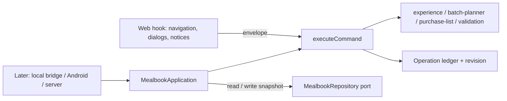

# Shared application command boundary - Plan

## Goal Capsule

**Objective:** Every change a person makes to their food record (recipes, weeks, shopping, cooking, eating and Undo) follows the same rules whichever surface makes it, and a repeated request never records the same food, purchase or meal twice. The web app behaves exactly as it does today.

**Means:** Typed commands executed by shared domain code, with an operation ledger for replays (KTD1–KTD3); the web hook dispatches through it (KTD4).

**Authority:** [D016](../decisions/README.md) and [the agent-friendly plan](2026-10-27-1205-feat-agent-friendly-mealbook-plan.md) (U1, KTD1) set the direction; [data and sync](../architecture/data-and-sync.md) owns the future operation and conflict semantics this boundary must not contradict; `PRODUCT.md` and [the interaction contract](../experience/interaction-contract.md) own user-visible behavior, which does not change.

**Stop conditions:** Stop and report if keeping current behavior would require changing the version-one backup format, if EV-03 cannot be kept green without changing what the user sees, or if a command needs a provider, network call or new dependency.

**Execution profile:** One branch (`claude/meal-planner-roadmap-8lha17`), pushed with `[skip netlify]`. U1–U4 ship together; U5 is a later issue. No pull request unless the owner asks.

---

## Product Contract

### Summary

Move the rules that change the food record out of `apps/web/src/useMealbook.ts` into `packages/meal-domain/` as typed commands. Each command carries an operation ID, runs against a snapshot (state, ledger, revision) and returns a typed result or a coded error. Navigation, dialogs, previews and notices stay in the web UI.

### Problem Frame

The web hook is the only place that knows how to start a cook, finish one, log a portion, change a week or cover a grocery line. The rules are interleaved with React state, navigation and messages, and record IDs are made inside the hook. Android, a local assistant bridge, a sync service and on-device counts would each have to copy those rules, and none of them could safely retry a request whose answer was lost.

### Requirements

- R1. Every durable record change the web UI makes today is a typed command in `packages/meal-domain/`; the hook keeps only navigation, dialogs, previews, notices and file handling.
- R2. Records and immutable snapshots come out the same as before for the same actions: recipe snapshots on cooks and batches, nutrition snapshots on logs, purchase history, ready-food stock.
- R3. Unknown nutrition, yields and quantities stay unknown; the boundary adds no defaults.
- R4. The caller supplies the ID of every record it needs to refer to later (cooking session, batch, log, week, shopping intent, purchase, match, manual item), so a command never invents an identity the caller cannot see.
- R5. Repeating an operation ID with the same command returns the first result and changes nothing; reusing it with a different command or context is rejected.
- R6. A command sent with a base revision that no longer matches is rejected as a conflict, without changing anything.
- R7. A repository port and a serialized application service run commands against stored snapshots one at a time, so two requests cannot both take the last portion.
- R8. Backups keep the version-one format; the operation ledger and revision are not part of `AppState`.

### Acceptance Examples

- AE1 (R5, parent AE4). A consume command is applied, the answer is lost, and the same command is sent again: one log, one stock reduction, the same log ID in both answers.
- AE2 (R5). The same operation ID arrives with a different number of portions: rejected with `OPERATION_KEY_REUSED`, nothing changes.
- AE3 (R6, parent AE3). A week edit is prepared at revision 7; another change moves the snapshot to revision 8; the edit is rejected with `CONFLICT` and the week is unchanged.
- AE4 (R7). Two consume commands for the last portion arrive together through the service: one succeeds, the other fails with no portions left, and stock never goes negative.
- AE5 (R2–R3). Finishing a cook through the command stores the same batch, recipe snapshot, learned time and today's choice as the current UI path; a recipe with unknown calories keeps them unknown.

### Scope Boundaries

In scope: commands for every durable action in the current hook, the snapshot executor, the replay ledger, coded errors, the repository port, an in-memory adapter, the serialized service, and the web hook dispatching through the executor.

Out of scope: an IndexedDB repository adapter (the web keeps its storage path), any network transport, MCP, accounts or sync, restore and recipe-bank import file handling (they stay device-level operations in the UI; the import merge rule moves into a command), queries beyond what the UI needs to drop duplicated rules, and U5's counts (planned below, built later).

---

## Planning Contract

### Key Technical Decisions

- **KTD1. Commands are data; the executor is a pure function over a snapshot.** `executeCommand(snapshot, envelope) → { snapshot, outcome }`. The envelope holds `operationId`, `command`, `context.date` (the caller's local date) and an optional `baseRevision`. Timestamps inside existing domain functions stay as they are; replay safety comes from the ledger, not from re-running.
- **KTD2. The ledger lives beside the state, not in it.** `ApplicationSnapshot = { state, ledger, revision }`. The ledger maps an operation ID to a fingerprint (stable JSON of command and context) and the stored result, bounded to the most recent 500 entries. It is what a future client outbox and the server's `sync_operation(owner_account_id, operation_id)` constraint in [data and sync](../architecture/data-and-sync.md) will carry. Backups stay version one (R8).
- **KTD3. Coded errors with the existing messages.** `ApplicationError` carries a code (`NOT_FOUND`, `INVALID_INPUT`, `CONFLICT`, `OPERATION_KEY_REUSED`, `NOT_READY`) and the user-facing message the hook shows today. Domain errors without a code become `INVALID_INPUT` with their message unchanged, so the UI's notices do not change.
- **KTD4. The web hook calls the executor synchronously.** Its `commit` keeps optimistic React state and the existing IndexedDB save; it holds the ledger and revision in memory. The post-commit normalization the hook does today (`ensureState`, keeping grocery changes, `ensureToday`) moves into the executor so every surface gets it.
- **KTD5. Results drive the UI.** Commands return what the UI needs to decide its next step (for example `cook.start` returns the session ID and whether it resumed one; `shop.addRecipe` returns whether the batch was already in the week; `recipe.update` returns whether nutrition was reset), so the hook does not re-derive rules to pick a notice.

### High-Level Technical Design

Execution order inside `executeCommand`: check the ledger (replay or reject reuse) → check `baseRevision` → run the command handler → normalize (`ensureState`, grocery changes, `ensureToday`) → record the result in the ledger → bump the revision. A handler that throws leaves the snapshot untouched.

### Assumptions and Dependencies

No new dependencies. Node's `node:test` runs the domain tests; Playwright EV-03 proves the UI. The Today reconciliation helpers in `apps/web/src/today-reconciliation.ts` move into the domain package because commands need them.

### Sequencing

U1 → U2 → U3, with U4 after U1. U5 waits on U3 and gets its own issue.

---

## Implementation Units

### U1. Contracts, ledger and executor core

**Goal:** The envelope, snapshot, result and error types, the fingerprint, the bounded ledger and the replay/conflict checks. **Requirements:** R5, R6, R8. **Dependencies:** none.

**Files:** `packages/meal-domain/src/application-contracts.ts`, `packages/meal-domain/src/application-commands.ts`, `tests/application-commands.test.ts`.

**Approach:** Fingerprint with key-sorted JSON so property order cannot change it. Keep the ledger as an ordered record and drop the oldest entries past 500. A rejected command (error, conflict, key reuse) is not recorded, so a corrected retry with a new ID works.

**Test scenarios:** identical replay returns the stored result and the same state object; changed payload under the same ID fails with `OPERATION_KEY_REUSED`; stale `baseRevision` fails with `CONFLICT`; a failing handler leaves revision and ledger unchanged; the ledger stays bounded.

**Verification:** `pnpm test` passes the new file.

### U2. Durable actions as commands

**Goal:** One handler per durable action, moved from the hook without changing behavior. **Requirements:** R1–R4. **Dependencies:** U1.

**Files:** `packages/meal-domain/src/application-commands.ts`, `packages/meal-domain/src/today-reconciliation.ts` (moved from `apps/web/src/`), `tests/application-command-parity.test.ts`.

**Approach:** Command families: `today.*` (slot, choose, next), `cook.*` (start including the extra-batch path, update, finish including one-off fulfilment and choosing today's batch), `food.*` (consume, undo), `recipe.*` (add, update with the nutrition-reset and yield-rescale rules, profile, import-merge), `week.*` (add recipe, propose, select, confirm, reroll, lock, portions, move use, skip use, move window, swap), `shop.*` (add recipe with the already-in-week check, remove intent, cover, match, aisle, manual add/toggle/remove), `log.*` (recipe log with caller-supplied ID, manual log), `targets.set`. Copy the rules verbatim first; refactor only after the parity tests pass.

**Test scenarios:** a scripted day (choose today, start, finish with remembered time, consume, Undo) produces the same batch, recipe snapshot, profile timing and stock as calling the domain functions the way the hook did; recipe update with changed ingredients resets nutrition and records the gap; a yield-only change rescales per-serving nutrition; unknown calories stay `null` through finish and consume; `shop.addRecipe` for a batch already in the active week reports it and adds no intent; a duplicate manual log ID changes nothing.

**Verification:** existing `tests/*.test.ts` and the new parity tests pass.

### U3. Web hook dispatches through the boundary

**Goal:** The UI keeps its behavior and loses its copies of the rules. **Requirements:** R1, R2. **Dependencies:** U2.

**Files:** `apps/web/src/useMealbook.ts`, `apps/web/src/today-reconciliation.ts` (removed or re-exporting), `apps/web/src/App.tsx` if it imports the moved helpers.

**Approach:** `commit` takes an envelope, runs `executeCommand` on the in-memory snapshot, saves `state` exactly as now and returns the outcome. IDs come from `makeId`; the date from the hook's `date`. Previews (`PREVIEW_SWAP`), the eat dialog's default amount, navigation and notices stay in the hook. Restore resets the in-memory ledger and revision.

**Test scenarios:** EV-03 (both tests, phone and desktop) passes unchanged.

**Verification:** `pnpm typecheck`, `pnpm build`, `pnpm test:e2e`.

### U4. Repository port and serialized service

**Goal:** A place for the local bridge, Android and a hosted store to plug in. **Requirements:** R5–R7. **Dependencies:** U1 (U2 for real commands in tests).

**Files:** `packages/meal-domain/src/application-service.ts`, `tests/application-service.test.ts`.

**Approach:** `MealbookRepository { read(): Promise<ApplicationSnapshot>; write(next, expectedRevision): Promise<void> }`; `write` rejects a revision mismatch. `createInMemoryRepository(initial)` for tests and local tools only; it never stands in for the user's app (parent plan R3). `MealbookApplication.execute(envelope)` queues calls so each reads, executes and writes before the next starts; a replayed outcome skips the write.

**Test scenarios:** AE1 lost-answer retry; AE4 concurrent last portion; a write conflict from another writer surfaces as `CONFLICT`; failed commands write nothing.

**Verification:** `pnpm test`.

### U5. Content-free week counts (later issue)

**Goal:** Count useful and repeat weeks on the device without reading recipes, targets or intake. **Requirements:** D016 track three; [funnel map v0](../growth/funnel-map.md). **Dependencies:** U3.

**Approach:** A pure query over the record: per week, whether the plan was confirmed, any shopping line was covered and at least one cook finished; then the first and second useful weeks. Output is counts and dates only. First use: the owner's weekly EV-08 entry. No telemetry, no network.

**Verification:** fixture tests; no personal fields in the output type.

---

## Verification Contract

`pnpm docs:check`, `pnpm typecheck`, `pnpm test` (EV-01), `pnpm build`, `pnpm test:e2e` (EV-03, after the build). CI runs the same steps on push.

## Definition of Done

- U1–U4 merged on the branch with all checks green locally and in CI; EV-03 unchanged and passing.
- `useMealbook.ts` contains no record-changing rule that is not a command call; navigation, dialogs, previews and notices remain.
- Version-one backups restore (EV-03 second test).
- Issue #31 checklist updated with evidence; U5 filed as its own issue.
- No experimental or abandoned code left in the diff.
